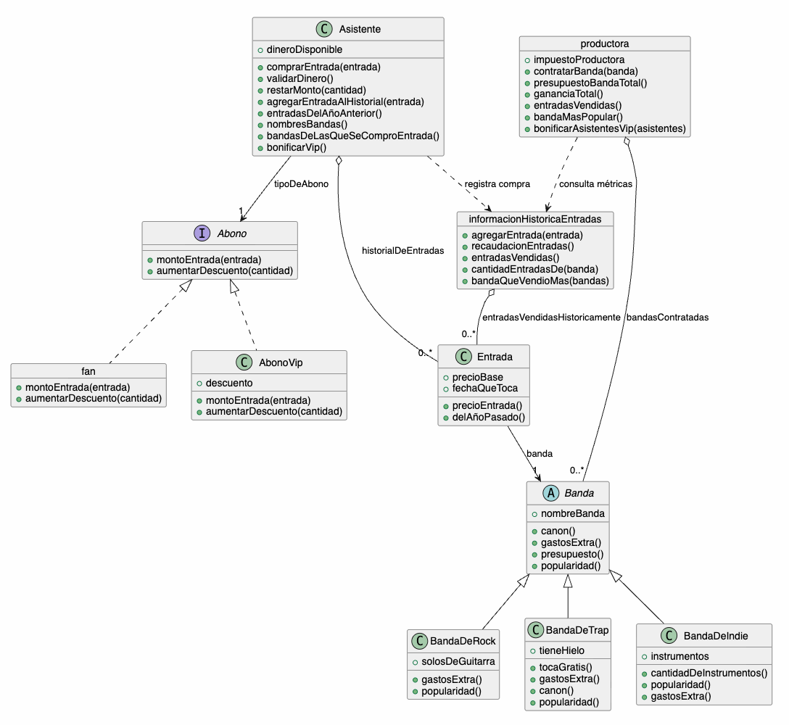

**Breve resumen de los comentarios que se hacen a lo largo del código justificando conceptos**  
**1. Polimorfismo**  
* **Dónde se usó:**  
    1. En las bandas (BandaDeRock, BandaDeTrap, BandaDeIndie), cuando la Productora interactúa con ellas para calcular presupuesto o popularidad.  
    2. En los abonos (fan y AbonoVip), cuando el Asistente les envía el mensaje montoEntrada(entrada).  
* **Justificación:** Permite que un objeto emisor (Asistente o Productora) trate a distintos objetos destinatarios por igual enviándoles el mismo mensaje, sin importar la clase concreta de cada uno y sin necesidad de usar condicionales (if).  
  
**2. Herencia y Reuso de Código**  
* **Dónde se usó:** En la jerarquía de Banda como superclase abstracta y las subclases BandaDeRock, BandaDeTrap y BandaDeIndie.  
* **Justificación:** Evita la duplicación de lógica compartida (como el canon base de $1.000.000 y el método presupuesto()) concentrándola en la superclase, mientras que las subclases redefinen (override) o especifican únicamente el comportamiento y atributos propios.  
  
**3. Composición vs. Herencia**  
* **Dónde se usó:** En la relación entre Asistente y tipoDeAbono (un asistente *tiene* un abono).  
* **Justificación:** Se eligió **composición** en lugar de herencia (AsistenteVip inherits Asistente) para ganar flexibilidad: esto permite que un asistente cambie su abono dinámicamente en tiempo de ejecución sin quedar atado a una clase fija.  
  
**4. Interfaz e Interfaz Compartida (Duck Typing)**  
* **Dónde se usó:** En el protocolo común de mensajes que entienden los abonos (montoEntrada(entrada)) y las bandas (popularidad(), presupuesto()).  
* **Justificación:** En Wollok las interfaces son implícitas. Al responder a los mismos mensajes públicos con igual aridad, los objetos comparten una misma interfaz, lo que garantiza el polimorfismo desde el punto de vista de quien consume sus servicios.  
  
**5. Encapsulamiento y Delegación**  
* **Dónde se usó:**  
    1. El Asistente le delega el cálculo del precio con descuento al tipoDeAbono.  
    2. El Asistente le delega a la Entrada saber si es delAñoPasado().  
* **Justificación:** Mantiene un bajo acoplamiento y protege el estado interno de los objetos. Cada objeto se encarga de sus propias responsabilidades sin exponer atributos innecesariamente ni permitir modificaciones directas sin pasar por un método.  
Diagrama de clases  
  
  
